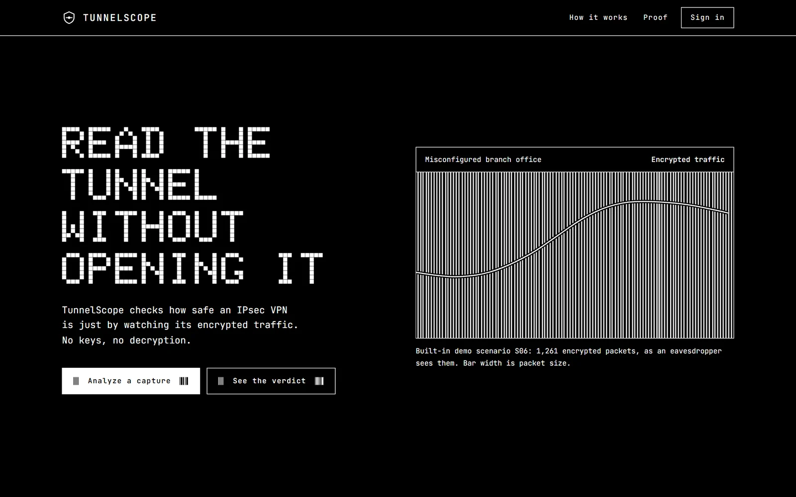
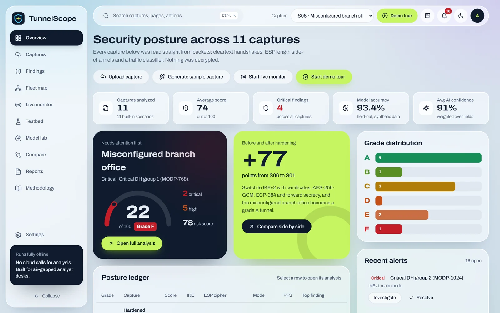
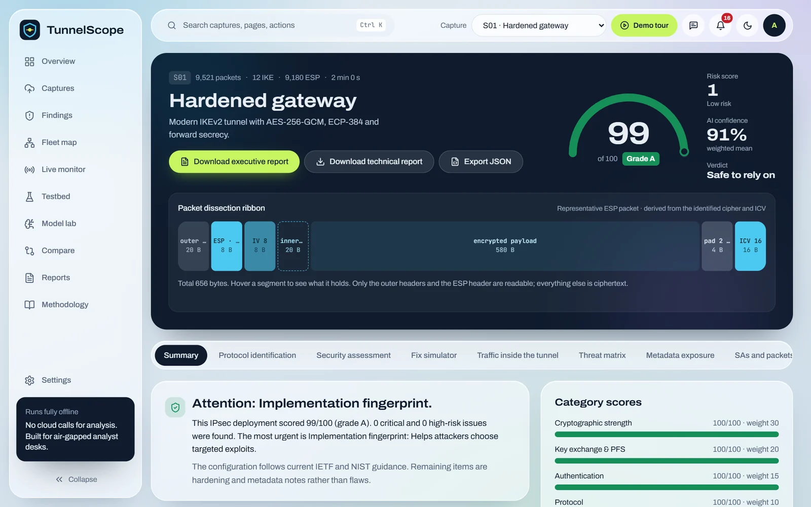
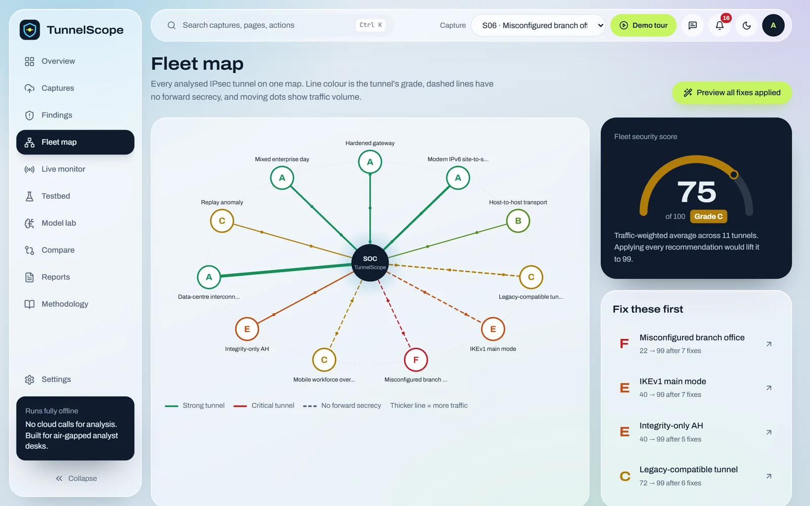
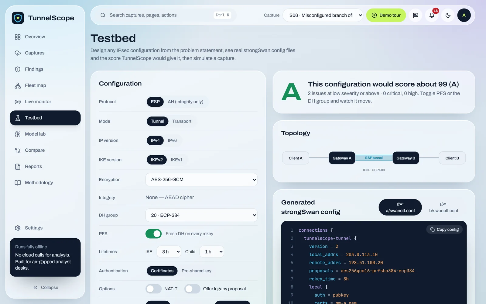
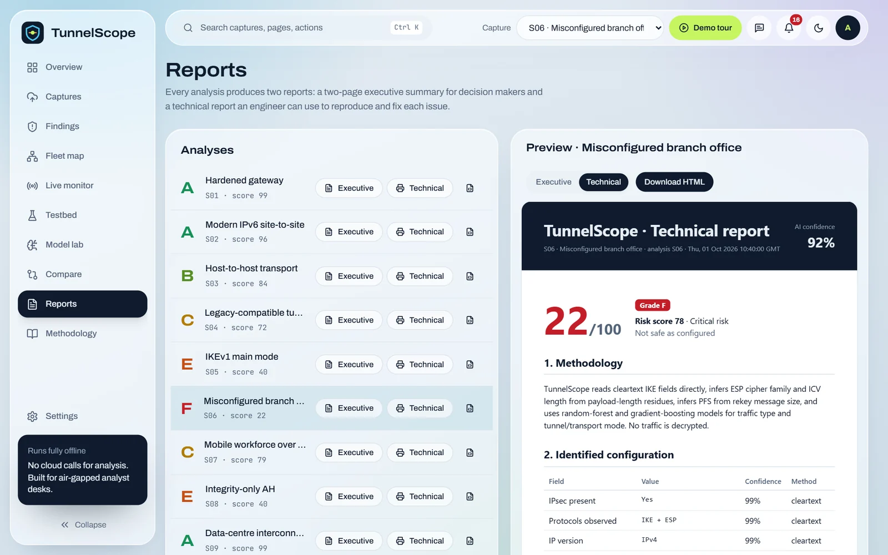
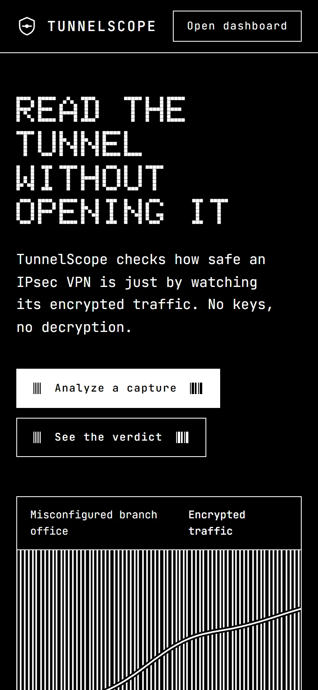

<div align="center">


**Reads encrypted IPsec VPN traffic and tells you how safe the tunnel is, without decrypting a single packet.**

[Live demo](https://tunnlescope.vercel.app) · Smart India Hackathon entry



</div>

## What it does

A passive observer can learn a lot from an IPsec tunnel without the keys: the IKE version, which cipher suite was negotiated, whether forward secrecy is on, packet sizes and timing. TunnelScope turns that into a grade from A to F. It also lists what the observer still learns and the exact configuration change that fixes each problem.

This repository is a complete front-end MVP. All 11 demo scenarios, the scoring engine, compliance checks, threat matrix and reports run in the browser with no backend.

## Screens

<table>
  <tr>
    <td width="50%"></td>
    <td width="50%"></td>
  </tr>
  <tr>
    <td><b>Overview.</b> A posture ledger of 11 IPsec deployments, graded A to F, with the worst one pinned at the top.</td>
    <td><b>Analysis.</b> Packet dissection ribbon, protocol identification with method and confidence, and the category scores behind the grade.</td>
  </tr>
  <tr>
    <td></td>
    <td></td>
  </tr>
  <tr>
    <td><b>Fleet map.</b> Every tunnel on one network map, plus a fleet-wide "all fixes applied" preview.</td>
    <td><b>Testbed.</b> Pick protocol, mode, cipher, DH group and lifetimes. It predicts the grade and generates the strongSwan config.</td>
  </tr>
  <tr>
    <td></td>
    <td align="center"></td>
  </tr>
  <tr>
    <td><b>Reports.</b> Executive and technical reports for each capture, printable to PDF.</td>
    <td><b>Mobile.</b> The landing page and the app both work at phone width.</td>
  </tr>
</table>

## Features

- **Analysis**: packet dissection, protocol identification, security assessment, threat matrix, metadata exposure, SAs and packets with a hex view.
- **Fix simulator**: toggle the recommended fixes, watch the score and grade recompute live, and copy the strongSwan config diff.
- **Ask TunnelScope**: offline Q&A about the current capture, built from the analysis data. No AI service is called.
- **Demo tour**: an 8-step guided walkthrough for judges (top bar, or <kbd>Ctrl</kbd> <kbd>K</kbd> → "Start demo tour").
- Live monitor, model lab, compare, findings explorer and settings.

## Problem statement coverage

| Requirement | Where it lives |
|---|---|
| VPN testbed (tunnel/transport, AES-128/256, GCM, CBC+HMAC, DH groups, PFS, IPv4/IPv6) | Testbed page, 11 scenarios in `src/data/scenarios.ts` |
| Traffic capture (IKE, ESP, AH, normal traffic) | Captures page, `.pcap` export per scenario, Live monitor |
| AI protocol identification | Analysis → Protocol identification, Model lab |
| Security assessment (crypto, compliance, SA parameters, lifetimes, replay, PFS, metadata) | `src/data/engine.ts`, Analysis → Security assessment |
| Score, executive and technical reports, risk score, threat matrix, AI confidence | Analysis page, Reports page |

## Run locally

Requires Node 18.18 or newer.

```bash
npm install
npm run dev        # http://localhost:5173
```

Signed-out visitors land on `/welcome`. Use **Sign in → Create an account** or **Continue with Google**. Without Firebase keys these create a local demo account stored in the browser.

## Deploy

`vercel.json` already sets the Vite framework, build command and SPA rewrites, so importing the repo into Vercel and pressing **Deploy** is enough. To switch from demo sign-in to real Firebase Authentication, add these variables and redeploy:

```
VITE_FIREBASE_API_KEY
VITE_FIREBASE_AUTH_DOMAIN
VITE_FIREBASE_PROJECT_ID
VITE_FIREBASE_APP_ID
```

Then add your Vercel domain under Firebase → Authentication → Settings → Authorized domains.

## Tech stack

React 18, TypeScript (strict), Vite 5, Tailwind CSS 3.4, Recharts, Framer Motion, Zustand, React Router 6, Firebase Auth (optional), React Bits components via the shadcn registry. Fonts are bundled locally, so the app works offline.

## Project layout

```
src/
  pages/        route screens (Landing, Overview, Analysis, FixSimulator, Fleet, ...)
  components/   shared UI: PacketRibbon, BarField, ScoreDial, Tour, AskPanel
  data/         scenarios, scoring engine, fixes, models, analysis builder
  lib/          types, store, auth, reports, pcap export, offline Q&A
```

## Honest limits

Analysis data is generated deterministically from the 11 scenario definitions. Uploaded pcaps are mapped to a scenario rather than parsed byte by byte, and the live monitor replays scenarios. The traffic classifier metrics come from a synthetic dataset.
